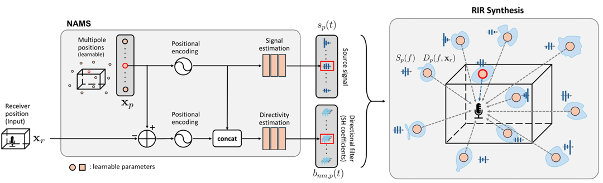
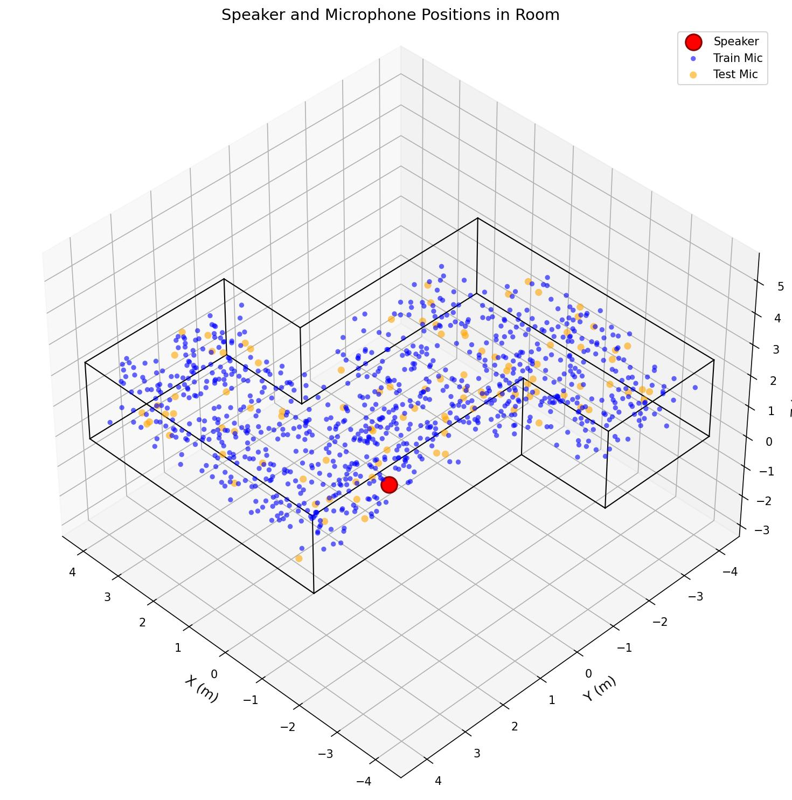
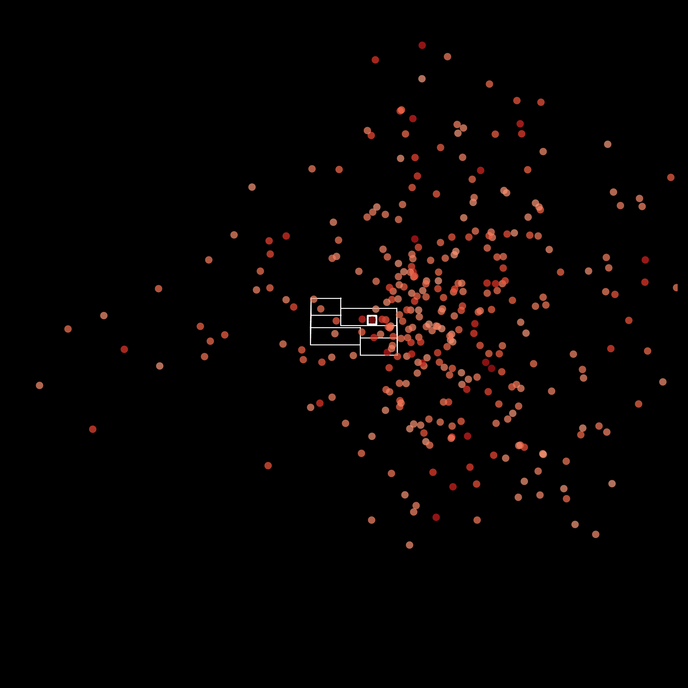

# [2026 ICASSP] Neural Acoustic Multipole Splatting

[[paper](https://ieeexplore.ieee.org/document/11463493)] [[Demo](https://bgw6287.github.io/nams-demo/)]  [[BibTex](#citation)] 


## Contents
- [NAMS framework](#NAMS_framework)
- [Abstract](#abstract)
- [Environment setup](#Environment_setup)
- [Usage](#usage)
- [Citation](#citation)


## NAMS_framework



## Abstract
RoomImpulse Response (RIR) prediction at arbitrary receiver positions is essential for practical applications such as spatial audio rendering. We propose Neural Acoustic Multipole Splatting (NAMS), which synthesizes RIRs at unseen receiver positions by learning the positions of neural acoustic multipoles and predicting their emitted signals and directivities using a neural network. Representing sound fields through a combination of multipoles offers sufficient flexibility to express complex acoustic scenes while adhering to physical constraints such as the Helmholtz equation. We also introduce a pruning strategy that starts from a dense splatting of neural acoustic multipoles and progressively eliminates redundant ones during training. Experiments conducted on both real and synthetic datasets indicate that the proposed method surpasses previous approaches on
most metrics while maintaining rapid inference. Ablation studies reveal that multipole splatting with pruning achieves better performance than the monopole model with just 20% of the poles.


## Environment_setup
This code was tested with the following environment:

- Ubuntu Linux
- Python 3.10
- PyTorch 2.7.1
- CUDA 12.6
- NVIDIA GPU, A6000
- tiny-cuda-nn

### Setup

```bash
conda create -n nams_env python=3.10 -y
conda activate nams_env

pip install torch==2.7.1 --index-url https://download.pytorch.org/whl/cu126
pip install -r requirements.txt
```sh
# install tiny-cuda-nn PyTorch extension (included in requirements.txt)
pip install git+https://github.com/NVlabs/tiny-cuda-nn/#subdirectory=bindings/torch
```

## Example Usage

```sh
python nams_runner.py --config ./config_files/meshrir.yml 
```


## Visualizations

| Dataset | Multipoles | Directivities |
|:---:|:---:|:---:|
|  |  |  |


## Citation

@inproceedings{baek2026neural,
  title={Neural acoustic multipole splatting for room impulse response synthesis},
  author={Baek, Geonwoo and Choi, Jung-Woo},
  booktitle={ICASSP 2026-2026 IEEE International Conference on Acoustics, Speech and Signal Processing (ICASSP)},
  pages={22592--22596},
  year={2026},
  organization={IEEE}
}

